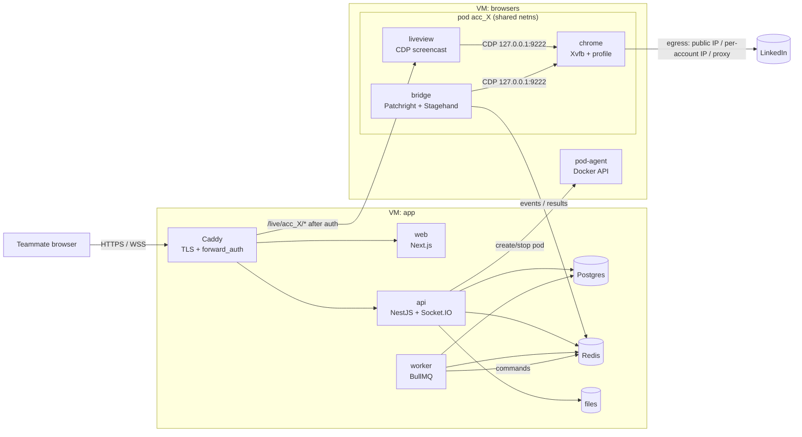

# LinkedIn Unified Team Inbox (Self-Hosted on Proxmox): Master Plan & Project Map

> **Working name:** LinkUnify (rename freely)
> **What it is:** a self-hosted "Unipile + shared inbox". Teammates connect their LinkedIn accounts by **logging in through a live browser window inside our app** (they handle 2FA/captcha themselves). Each account then runs 24/7 in its own isolated Chrome on our Proxmox server. The whole team works from **one unified inbox** across all accounts, and can open any account's **real LinkedIn** live.
> **Hosting:** Proxmox VE, own hardware, public IP. 100% self-hosted, no SaaS vendors.
> **Doc date:** 2026-10-04 · **Phase 0 kit:** [`tools/phase0-spike/`](../tools/phase0-spike/README.md) (Live View tested locally)
>
> **Build status (2026-10-05):** MVP and the v2 team features are built. See [README](../README.md) and [architecture.md](architecture.md).
> - **Monorepo:** pnpm workspaces + Turborepo + Biome; shared `@linkunify/contracts`; all apps in TypeScript (Node 24 native type stripping); one multi-target Dockerfile; GitHub Actions CI with a Docker end-to-end test.
> - **Implementation choices vs this plan:**
>   - Fastify instead of NestJS
>   - Vite/React SPA instead of Next.js
>   - SQL migrations instead of Prisma
>   - one VM to start
>   - Live View + bridge share one sidecar per account
>   - self-healing is a built-in module (`apps/sidecar/src/bridge/heal.ts`) instead of Stagehand, because Stagehand 4 runs as a browser extension and the account browsers block extensions
> - **Built since the MVP:** labels, snooze, "awaiting reply" view, saved replies, signed webhooks, web push + installable app, email alerts, AI reply drafts (Ollama or Claude).
> - **Still open:**
>   - verification against a real LinkedIn account (see [bridge-maintenance.md](bridge-maintenance.md))
>   - multi-VM browser hosts (§5)
---

## 0. Core Idea

```
 Teammates (any browser)                         Proxmox host (public IP)
 ───────────────────────          ┌──────────────────────────────────────────────────────────────┐
  Unified Inbox  ───HTTPS────────►│ VM app:      caddy · web · api · worker · postgres · redis   │
  Live LinkedIn  ───WSS──────────►│                │ (private bridge vmbr1)                       │
  "Connect account"               │ VM browsers:   pod-agent                                     │
                                  │   pod acc_A:  chrome(Xvfb) ◄─CDP─ liveview + bridge          │
                                  │   pod acc_B:  chrome(Xvfb) ◄─CDP─ liveview + bridge          │
                                  └──────────────────────────────┬───────────────────────────────┘
                                                                 │ outbound via public IP
                                                                 ▼ (or per-account IP / proxy)
                                                              LinkedIn
```

**Per LinkedIn account = one "pod"** (three containers sharing one network namespace):

| Container | Job |
|---|---|
| `chrome` | Real Google Chrome (headful on a virtual display), **persistent profile** = the LinkedIn session |
| `liveview` | **CDP screencast Live View**: streams the tab to web users and sends their mouse/keyboard back (login, 2FA, anything) |
| `bridge` | Reads messages from the page's own network traffic and realtime stream; sends messages/images with human pacing |

### Why this is the current (2026) method
| Old way | Problem | Current way (this plan) |
|---|---|---|
| Ask for LinkedIn password, log in by script | Captchas/2FA break it; storing passwords | **Human logs in through Live View**: 2FA/captcha solved by the person, no password stored |
| Chrome extension uploads cookies to a server | Session suddenly jumps to a server IP. Security researchers rate it the highest-risk pattern | Session is **born** on the server: same browser, IP and fingerprint from the first login onward |
| VNC / noVNC / Neko (WebRTC) to show the browser | Heavy video encoding, UDP ports, awkward to embed | **CDP screencast over WebSocket** (the method behind Browserbase/Cloudflare "Live View", BetterWright, HITL bridges): one HTTPS port, light, embeds natively in our React app |
| HTML scraping | Breaks with every redesign | Read LinkedIn's own JSON + realtime events via CDP |
| Fixed selectors for sending | Breaks on UI changes | **Stagehand** self-healing actions on top of **Patchright** |

### Honest risks
1. **LinkedIn's User Agreement forbids sharing accounts and using automation.** This design keeps each account looking like one consistent user, but a restricted or banned account is still possible. Start with non-critical accounts.
2. **Everyone with access sees private messages.** Use per-account grants (§7) plus an internal confidentiality agreement.
3. **The bridge depends on LinkedIn's internal web app,** which changes without notice. Plan maintenance (§11).
4. **IP reputation matters.** See §5.3.

---

## 1. Scope

### 1.1 MVP
- App accounts for teammates (email + password, TOTP optional). Roles: `OWNER`, `ADMIN`, `MEMBER`
- **Connect LinkedIn via Live View** (self-service, about 1 minute): pod is created → teammate logs in + 2FA in an embedded live browser → status `CONNECTED`
- **Multiple accounts per workspace**, each in its own pod
- **Per-account access grants:** `READ | REPLY | FULL` (FULL = may use Live LinkedIn). Default: the whole team sees all accounts
- **Unified Inbox:** all accounts in one list with account badge/filter; Focused/Other/unread/starred/archived; search
- **Thread view** with LinkedIn parity: text, images, files, GIFs, voice notes (playback), link previews, reactions (display), read receipts, typing indicators, group chats, InMail/Sales Nav threads if available
- **Send:** text, images, files, start a new chat with a connection
- **Team collaboration:** live presence, "Ali is replying…", thread lock, "sent by" badge, internal notes
- **Connections page** per account (synced, searchable, "Message" button)
- **Live LinkedIn** tab per account (feed, profiles, posting, everything else, the real site)
- **Session health:** checkpoint/logout detection → sending paused → banner + email → re-login via Live View
- **Audit log** + **send pacing/caps** per account

### 1.2 v2
Assignment and SLA timers, labels, snooze, templates, send reactions/voice notes, AI reply drafts (local LLM), CRM webhooks, PWA push, Camoufox pod type, per-account dedicated IPs automation.

### 1.3 Out of scope
Bulk outreach, auto-connect campaigns, scraping non-connections.

---

## 2. Architecture



### 2.1 Services

| Service | Where | Tech | Role |
|---|---|---|---|
| `caddy` | app VM | Caddy 2 | TLS (Let's Encrypt), routing, `forward_auth` so only authorized users reach a pod's Live View |
| `web` | app VM | Next.js 15, Tailwind, shadcn/ui | Inbox, connect flow, Live LinkedIn, connections, team, audit |
| `api` | app VM | NestJS 11, Prisma, Socket.IO | Auth, grants, REST, realtime, audit, pod lifecycle requests |
| `worker` | app VM | BullMQ | Ingest bridge events, per-account send queues, connection sync, health/alerts |
| `postgres`, `redis` | app VM (MVP) → data VM later | PG 16, Valkey 8 | Data, queues, pub/sub, locks |
| `pod-agent` | browsers VM | Node + `dockerode` | Small authenticated HTTP API on the private network: create/start/stop/delete pods, allocate IPs/ports, report health |
| `chrome` *(per account)* | browsers VM | Google Chrome stable on Xvfb | The account's only browser. Persistent profile volume |
| `liveview` *(per account)* | browsers VM | Node + `ws`, raw CDP | Screencast + input. Only `Page`/`Input`/`DOM` domains (no `Runtime.enable`) |
| `bridge` *(per account)* | browsers VM | Node + **Patchright** + **Stagehand** | Read (network interception + realtime), write (paced actions), health |

---

## 3. Connecting an Account (Live View login)

```
Teammate clicks "Connect LinkedIn"
  1. api → pod-agent: create pod acc_X  (timezone/language = teammate's, egress = §5.3 policy)
  2. web opens the Live View panel  →  wss://app.example.com/live/acc_X/ws  (Caddy checks session + grant)
  3. Teammate sees linkedin.com/login, types email/password, completes 2FA / captcha
  4. bridge watches: li_at cookie present + /feed loads + own profile URN readable
  5. status = CONNECTED → panel closes → initial sync starts (recent conversations, connections)
```

Details:
- **Fingerprint:** keep Chrome's **genuine** Linux fingerprint (spoofing a Windows UA on Linux creates detectable inconsistencies). Match **timezone + language** to the account owner. What matters most is **consistency over time**.
- **Passkeys don't work** in a remote browser. Teammates use password + 2FA (authenticator, SMS, or "approve in LinkedIn app").
- **Re-login:** when health detects a checkpoint/logout, the same panel opens for the account owner (or anyone with `FULL`).
- **Disconnect:** pod stopped, profile volume wiped, messages kept or deleted per retention setting.
- **Control lock in Live View:** many can watch; one controls at a time ("Request control" / auto-release after 60 s idle). Every control session is audited.

---

## 4. The Bridge

### 4.1 Attach
- Shares the pod's network namespace → CDP at `127.0.0.1:9222`. **CDP is never exposed.**
- Uses its **own window** (`Target.createTarget {newWindow: true}`) so it never steals the tab a human is watching.
- Driver: **Patchright** (Playwright fork that avoids the common CDP automation leaks). Verify its patches apply in `connectOverCDP` mode during Phase 1.

### 4.2 Read
| Mechanism | What |
|---|---|
| Network interception | Capture JSON that LinkedIn's messaging page loads (conversations, messages, participants) |
| Realtime | CDP `Network.eventSourceMessageReceived` (SSE) / WebSocket frames → new messages, reads, typing in seconds |
| Reconcile | Every 5–10 min (jittered): refresh conversation list in the bridge window |
| Connections | Daily, paced pagination → cache in DB |
| Attachments | Download through the session → `files` storage, served to teammates via signed URLs |

Endpoints/payload shapes live in versioned adapters (`adapters/v1.ts`), built from Phase 0 recordings.

### 4.3 Write
- **One queue per account, concurrency 1**, 2–8 s jitter, daily caps, optional quiet hours.
- **Stagehand** actions (`act("type the message into the composer")`, `act("click Send")`) are cached as plain selectors and replayed at full speed. When LinkedIn changes the UI, the LLM re-finds the element once and updates the cache. LLM = **local via Ollama** (fully self-hosted) or an API model.
- Images/files: `setInputFiles` on the composer input.
- Confirmation: the sent message must appear in intercepted data → `SENT`, otherwise `FAILED` + retry.

### 4.4 Health
Every 60 s: cookie present, lightweight authenticated request OK, no login/checkpoint URL. On failure: `NEEDS_ATTENTION`, pause queue, alert, open re-login flow.

### 4.5 Contract (Redis Streams)
```
li:{acc}:cmd     worker → bridge   { id, type: send_text|send_file|start_chat|sync_connections|resync, payload }
li:{acc}:result  bridge → worker   { cmdId, ok, messageUrn?, error? }
li:events        bridge → worker   { accountId, type: message.created|message.read|typing|conversation.updated|session.status, data }
```

---

## 5. Proxmox Infrastructure

### 5.1 Host & VMs

| VM | vCPU | RAM | Disk | Runs |
|---|---|---|---|---|
| `app` | 4 | 8 GB | 80 GB | caddy, web, api, worker, postgres, redis |
| `browsers-1` | 8 | 16–32 GB | 100 GB | pod-agent + account pods |
| `pbs` (optional, ideally on another machine) | 2 | 4 GB | big | Proxmox Backup Server |

- Use **VMs (not LXC) for Docker**. CPU type `host`, VirtIO SCSI + `discard`, QEMU guest agent.
- **Pod sizing:** ~0.8–1.2 GB RAM per idle Chrome; CPU near idle except during Live View or sync. One 32 GB browsers VM ≈ **15–25 accounts**. Add `browsers-2` VMs to scale. pod-agent registers each VM with the api.

### 5.2 Networking

```
Internet ── public IP ── Proxmox host
                         ├─ vmbr0 (WAN)
                         └─ vmbr1 (LAN 10.10.10.0/24, NAT/masquerade to public IP)
                               ├─ app         10.10.10.10   ← DNAT 80/443 from public IP
                               └─ browsers-1  10.10.10.20   (no inbound from internet)
```
- Port-forward only **80/443 → app VM**. Live View traffic goes through Caddy on the app VM to `browsers-1:<pod port>` on the private bridge.
- **Proxmox UI (8006) and SSH:** never open to the internet. Use WireGuard/Tailscale or your admin IP only.
- Proxmox firewall enabled at datacenter + VM level. On the browsers VM, allow inbound only from `app`.
- If you have **one public IP**: everything above via NAT on the host (iptables or an OPNsense VM).
- If you have **a subnet (e.g. /29)**: see §5.3, option B.

**Comcast Business specifics:**
- **Static block:** Comcast's gateway keeps one IP of the block for itself (usually the highest usable). Put the Proxmox host's `vmbr0` on one of the others with the gateway's IP as the default route, so there's no double NAT.
- **Single static IP:** use port forwarding 80/443 → Proxmox host (or app VM) in the gateway's admin page. Set the gateway firewall to allow these ports.
- **DNS:** `A app.example.com → <public IP>`. Caddy gets Let's Encrypt certificates via HTTP-01 on port 80.
- **Uptime:** add a UPS for the Comcast modem + Proxmox host. If the line is down, the bridges pause and resume automatically. LinkedIn just sees the "office" offline.

### 5.3 Egress IP policy (important)

| Situation | Verdict | What to do |
|---|---|---|
| Public IP is a **business/home ISP** line, team in the same country | ✅ Best case: looks like an office | All accounts egress via the public IP |
| Public IP is a **datacenter/hosting** range (colo, Hetzner/OVH-type) | ⚠️ LinkedIn trusts datacenter IPs less | Per-account **ISP/residential proxy** in the owner's country (`PROXY_SERVER` per pod) |
| Accounts belong to people in **different countries** | ⚠️ Location mismatch triggers checks | Proxy in each owner's country for those accounts |
| You have **multiple public IPs** | ✅ | Option B: give each pod its own outbound IP via a per-pod Docker network + `iptables SNAT` (pod subnet → specific public IP). Dedicated IP per account, no third-party proxy |

> ✅ **Decision (2026-10-04):** our egress is a **Comcast Business static IP (Chicago region, ARIN `CHICAGO-CBC-69`)**. That's an ISP business line, so no proxies are needed for US-based accounts. All pods egress through it by default (`egressMode = "public"`).
> - Default pod timezone **`America/Chicago`**, language `en-US`. Override per account if the owner lives elsewhere in the US.
> - Accounts owned by people **outside the US** still need a proxy in their country.
> - If the Comcast plan includes a **static block** (Comcast Business sells /29 = 5 usable IPs, /28 = 13), use the extra IPs for per-account egress (option B). With 5 IPs: 1 for inbound + app, 4 for pod egress groups, about 20–40 accounts total.
> - Keep the actual IP in `.env` / DNS only, not in docs or code.

Rules: **an account's IP never changes** once connected. Spread accounts over IPs if you have them (≤ ~5–10 accounts per IP is a comfortable office-like ratio). WebRTC leak is blocked by Chrome policy.

### 5.4 Backups & ops
- Proxmox Backup Server: nightly VM snapshots of `app` and `browsers-*` (profiles = sessions)
- Plus nightly `pg_dump` + `restic` of `files` to off-site storage
- Monthly restore drill
- UPS + Proxmox notifications (email) for host issues

### 5.5 Cost
Hardware you already own + domain. **No per-seat or per-account fees.** Optional extras: ISP proxies only for accounts that need them (§5.3), off-site backup storage.

---

## 6. Project Map

```
linkunify/
├── apps/
│   ├── web/                               # Next.js
│   │   └── app/(app)/
│   │       ├── inbox/                     # unified inbox (+ [conversationId])
│   │       ├── accounts/                  # connect, status, re-login, grants
│   │       │   └── [accountId]/connect/   # embedded Live View login
│   │       ├── live/[accountId]/          # Live LinkedIn
│   │       ├── connections/[accountId]/
│   │       ├── team/  audit/  settings/
│   │   └── components/
│   │       ├── inbox/   ConversationList, Thread, Composer, Reactions, ReadReceipts,
│   │       │            TypingIndicator, ThreadLock, SentByBadge, AccountBadge
│   │       └── live/    LiveView (canvas, input capture, control lock, file chooser)
│   │
│   ├── api/                               # NestJS
│   │   └── src/modules/
│   │       auth · users · team · accounts (connect/re-login/disconnect, grants)
│   │       conversations · messages · files · connections · live (forward_auth)
│   │       pods (talks to pod-agent) · session-health · audit · realtime
│   │
│   ├── worker/                            # BullMQ processors
│   │   ingest-events · outbound-send (per account) · results · connections-sync · health
│   │
│   ├── pod-agent/                         # runs on each browsers VM
│   │   └── src/ pods.service.ts (dockerode) · template.ts · egress.ts (proxy/SNAT) · ports.ts
│   │
│   ├── liveview/                          # ← from phase0/liveview (+ control lock, auth by signed ticket)
│   │
│   ├── bridge/
│   │   └── src/
│   │       browser.ts (Patchright connectOverCDP, own window)
│   │       linkedin/adapters/v1.ts · interceptor.ts · realtime.ts · health.ts
│   │       linkedin/actions/ send-text.ts · send-file.ts · start-chat.ts · sync-connections.ts
│   │       stagehand.ts · pacing.ts · streams.ts
│   │
│   └── chrome/                            # ← from phase0/browser (Dockerfile, start.sh, policies.json)
│
├── packages/  db (Prisma) · shared (zod types, events, commands) · config
├── infra/
│   ├── app-vm/docker-compose.yml          # caddy, web, api, worker, postgres, redis
│   ├── browsers-vm/docker-compose.yml     # pod-agent (pods are created dynamically)
│   ├── caddy/Caddyfile
│   ├── proxmox/                           # VM creation notes, NAT/iptables, firewall rules
│   └── backup/
├── phase0/                                # ✅ spike kit
├── tests/  fixtures/ (anonymized Phase 0 recordings) · e2e/
└── docs/   MASTER_PLAN.md · RUNBOOK.md · BRIDGE_MAINTENANCE.md
```

---

## 7. Data Model (Prisma sketch)

```prisma
enum Role { OWNER ADMIN MEMBER }
enum AccessLevel { READ REPLY FULL }
enum SessionStatus { PROVISIONING AWAITING_LOGIN CONNECTED NEEDS_ATTENTION DISCONNECTED }
enum Direction { INBOUND OUTBOUND }
enum MessageStatus { QUEUED SENDING SENT FAILED }

model User {
  id String @id @default(cuid())
  email String @unique
  name String
  passwordHash String
  role Role @default(MEMBER)
  totpSecret String?
  disabledAt DateTime?
  grants AccountGrant[]
}

model LinkedInAccount {
  id            String @id @default(cuid())
  label         String                 // "Sara – Sales"
  ownerUserId   String
  profileUrn    String? @unique
  displayName   String?
  avatarKey     String?
  status        SessionStatus @default(PROVISIONING)
  hostVm        String?                // "browsers-1"
  podName       String?                // "pod-acc_123"
  egressMode    String                 // "public" | "dedicated_ip" | "proxy"
  egressRefEnc  String?                // encrypted proxy URL or IP id
  timezone      String
  language      String
  sendPaused    Boolean @default(false)
  dailySendCap  Int     @default(80)
  lastHealthyAt DateTime?
  grants        AccountGrant[]
}

model AccountGrant {
  accountId String
  userId    String
  level     AccessLevel @default(REPLY)
  @@id([accountId, userId])
}

model Contact {
  id String @id @default(cuid())
  accountId String
  memberUrn String
  name String
  headline String?
  company String?
  avatarKey String?
  profileUrl String?
  isConnection Boolean @default(false)
  @@unique([accountId, memberUrn])
}

model Conversation {
  id String @id @default(cuid())
  accountId String
  threadUrn String
  folder String?                         // focused | other | requests | inmail
  title String?
  lastMessageAt DateTime?
  lastMessagePreview String?
  unreadCount Int @default(0)
  isArchived Boolean @default(false)
  isStarred Boolean @default(false)
  assignedToId String?
  lockedById String?
  lockedUntil DateTime?
  @@unique([accountId, threadUrn])
  @@index([accountId, lastMessageAt(sort: Desc)])
}

model Message {
  id String @id @default(cuid())
  conversationId String
  messageUrn String? @unique
  clientId String? @unique
  direction Direction
  senderContactId String?
  sentByUserId String?                   // teammate who sent it from our app
  text String?
  reactions Json?
  status MessageStatus
  sentAt DateTime
  readAt DateTime?
  attachments Attachment[]
  @@index([conversationId, sentAt])
}

model Attachment {
  id String @id @default(cuid())
  messageId String
  kind String                            // image | file | gif | audio | video | link
  fileName String?
  mimeType String?
  sizeBytes Int?
  storageKey String?
  meta Json?
}

model Note { id String @id @default(cuid()) conversationId String userId String text String createdAt DateTime @default(now()) }

model AuditLog {
  id String @id @default(cuid())
  userId String?
  accountId String?
  action String                          // message.send, live.control, account.connect, grant.change…
  meta Json?
  ip String?
  createdAt DateTime @default(now())
}
```
Search: Postgres full-text (GIN) on messages and contacts.

---

## 8. API & Realtime (summary)

```
AUTH         POST /auth/login · /auth/logout · GET /me
ACCOUNTS     POST /accounts                     → creates pod, returns { accountId, liveUrl }
             POST /accounts/:id/relogin · DELETE /accounts/:id · GET /accounts (with status)
             PUT  /accounts/:id/grants          [{ userId, level }]
LIVE         GET  /live/auth                    ← Caddy forward_auth (session + grant + control lock)
             POST /live/:accountId/control      request/release control
INBOX        GET  /conversations?accountId=&folder=&unread=&q=&cursor=
             GET  /conversations/:id/messages · POST /conversations/:id/messages
             POST /conversations/:id/read · /lock · PATCH /conversations/:id · POST /conversations/:id/notes
FILES        POST /files · GET /files/:id
CONNECTIONS  GET  /accounts/:id/connections?q= · POST /accounts/:id/connections/:contactId/message
AUDIT        GET  /audit
```
Socket.IO events: `message.created`, `message.status`, `message.read`, `typing`, `conversation.updated`, `thread.locked`, `presence`, `account.status`, `live.control`.

---

## 9. Caddy routing (sketch)

```
app.example.com {
  handle /api/*        { reverse_proxy api:4000 }
  handle /socket.io/*  { reverse_proxy api:4000 }

  # /live/{accountId}/... → that pod's liveview on the browsers VM
  @live path_regexp live ^/live/([a-z0-9_]+)/(.*)$
  handle @live {
    forward_auth api:4000 {
      uri /live/auth?account={re.live.1}
      copy_headers X-Pod-Upstream
    }
    uri strip_prefix /live/{re.live.1}
    reverse_proxy {http.request.header.X-Pod-Upstream}   # e.g. 10.10.10.20:21007, set by api
  }

  handle { reverse_proxy web:3000 }
}
```

---

## 10. Security Checklist

- [ ] Live View reachable **only** via Caddy + `forward_auth` (session + grant `FULL` or connecting owner). Pod ports bound to the private bridge only.
- [ ] Production Live View uses **short-lived signed tickets** issued by the api (not a static token).
- [ ] CDP never published. Bridge/liveview share the pod netns.
- [ ] Chrome password manager off. LinkedIn passwords never touch our app.
- [ ] Profile volumes encrypted at rest (LUKS on the browsers VM disk or ZFS native encryption on the host).
- [ ] Argon2id, TOTP, rate-limited login, session revoke on user disable.
- [ ] Server-side grant checks on every endpoint and socket room.
- [ ] Audit log: sends, Live View control sessions, connects/disconnects, grant changes, exports.
- [ ] No message bodies in logs. Error tracker scrubs PII.
- [ ] Proxmox UI/SSH only via VPN. Proxmox and VM firewalls on. Automatic security updates.
- [ ] Backups encrypted, off-site copy, restore tested.
- [ ] Team confidentiality policy (everyone sees private messages).

**Account safety:** per-account queue concurrency 1, jitter, daily caps (start ~80/day), quiet hours, reconcile ≥ 5 min, connection sync daily and slow, stable IP forever, and on any checkpoint pause and let a human resolve it.

---

## 11. Keeping the Bridge Alive

- Versioned adapters + fixture tests (from Phase 0 recordings, anonymized)
- Stagehand self-healing for UI actions
- Canary every 15 min per account: "conversation list parsed", "realtime alive". On failure, alert and show the inbox banner *"sync degraded, use Live LinkedIn"*
- Live LinkedIn always works as the fallback
- Budget a few hours per month for LinkedIn changes

---

## 12. Roadmap

| Phase | Time | Deliverables | Exit criteria |
|---|---|---|---|
| **0. Spike** | 3–5 days | **Ready:** [`tools/phase0-spike/`](../tools/phase0-spike/README.md): Chrome pod + Live View + check/record/send scripts | All 8 exit criteria pass on the Proxmox VM |
| **1. Foundation** | Week 1–2 | Proxmox VMs + NAT + firewall, monorepo, app compose, Caddy, auth, team, CI/CD | Team logs in at `https://app.example.com` |
| **2. Pods + connect flow** | Week 2–3 | pod-agent, pod template, egress modes, Live View embedded + signed tickets + control lock, connect/re-login | Two teammates connect their own accounts via Live View |
| **3. Bridge read** | Week 4–5 | Interceptor, realtime, reconcile, ingest, attachments, health | New messages from all accounts in DB in < 5 s |
| **4. Unified Inbox** | Week 5–6 | Multi-account list, threads with parity rendering, search, presence, typing, lock, grants | Team reads everything live |
| **5. Bridge write** | Week 6–7 | Patchright + Stagehand actions, per-account queues, text/image/file, start chat, confirmations | Team replies with text + images reliably |
| **6. Connections + Live LinkedIn** | Week 7–8 | Connections sync/page, Live LinkedIn tab with grants | Full workflow without opening linkedin.com |
| **7. Hardening** | Week 8–9 | Audit, PBS backups + restore drill, canaries, alerts, caps, security review, RUNBOOK | §10 checklist done |
| **8. v2** | Week 10+ | Assignment/SLA, labels, templates, reactions/voice send, AI drafts (Ollama), PWA push, dedicated-IP automation | — |

**Estimate:** ~9 weeks for one experienced full-stack developer, ~5–6 weeks for two.

---

## 13. Testing

- Unit: adapters vs fixtures, pacing, grants
- Integration: api + worker + PG/Redis (Testcontainers) with a **mock bridge** replaying fixtures
- Live View: Playwright test against a local Chrome (click, type, paste, scroll, file chooser, tab switch)
- E2E (our app only): connect (mocked) → inbox → reply → `SENT`
- Production canaries are read-only. **Never** automated test sends to real contacts.
- Load: 20–50 concurrent users on Socket.IO + inbox; 5 simultaneous Live View viewers per pod

---

## 14. Monitoring

| What | Tool | Alert |
|---|---|---|
| Host/VMs | Proxmox notifications + node exporter | Disk/RAM/CPU, failed backups |
| Containers | Uptime Kuma | Any service down > 1 min |
| Account sessions | bridge health | `NEEDS_ATTENTION` → email + in-app banner |
| Sync canary | bridge | Parse failures, no realtime for > 30 min in work hours |
| Send queues | Bull Board (admin) | 3 failures in a row → auto-pause that account |
| Errors/logs | GlitchTip (self-hosted Sentry-compatible) + Dozzle/Loki | New issues |

---

## 15. Open Decisions

- [x] Public IP type: **Comcast Business, Chicago**, an ISP line, so no proxies for US accounts (§5.3)
- [ ] Single static IP or a static block (/29, /28)? Check the Comcast Business account or the gateway's admin page
- [ ] Are all account owners in the same country?
- [ ] App name + domain
- [ ] Default grant for new accounts (whole team `REPLY`?)
- [ ] Message retention after disconnect
- [ ] Self-healing LLM: local (Ollama) or API

---

## 16. Next Steps

1. Create the `browsers-1` VM on Proxmox (Phase 0 can run on just this VM).
2. Follow [`phase0/README.md`](../tools/phase0-spike/README.md): `docker compose up -d --build`, log in through Live View, run `check` / `record` / `send-test`.
3. Run it for a week with one non-critical account and fill in the exit checklist.
4. Then Phase 1: VMs/network/firewall per §5, scaffold the monorepo.
